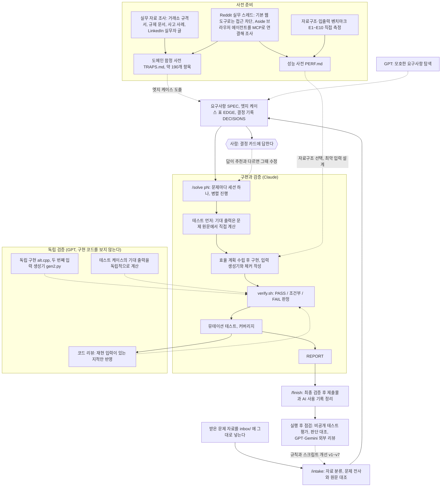

# cotest-harness

> **English summary.** A harness for building order management system (OMS) components in C++20 with AI agents under a time limit, where the question is not "can the AI write it" but "how do we know it is right."
> Claude Code implements; OpenAI GPT (Codex) independently writes a second implementation and derives expected outputs without seeing the first; scripts, not models, give the verdict (PASS / conditional / FAIL).
> Before any code is written, the agents work from two dictionaries built for this project: about 190 OMS failure patterns collected from exchange specs, incident reports, LinkedIn and Reddit practitioner threads, and a performance dictionary backed by benchmarks measured on this machine.
> The harness itself was reviewed by OpenAI GPT and Google Gemini, and revised seven times across five timed runs (last run: 3/3 PASS, 94/94 held-out tests, 93 minutes).
> Everything below is in Korean.

---

## 1. 개요

제한 시간 안에 주문 관리 시스템(OMS) 문제를 C++20으로 구현할 때, AI 에이전트가 쓴 코드를 어떻게 믿을 것인가를 다루는 작업 공간입니다.

AI가 쓴 코드를 사람이 한 줄씩 읽어 확인하는 방식은 150분에 문제 세 개를 푸는 조건에서는 성립하지 않습니다. 그래서 "읽고 믿는다" 대신 "믿을 근거를 기계가 내게 한다"로 설계했습니다. 구현은 Claude Code가 하고, OpenAI GPT(Codex)가 그 코드를 보지 않은 채 독립 구현과 기대 출력을 따로 만들며, 통과 여부는 스크립트가 판정합니다. 사람은 문제에 명시되지 않은 부분의 판단과 시간 운영만 맡습니다.

마지막 리허설 결과는 다음과 같습니다.

- 문제 3개 모두 PASS, 비공개 테스트 94/94, 최대 규모 입력 20/20 통과(가장 느린 입력 0.64초)
- 접수부터 제출물 정리까지 93분(제한 150분)
- Claude Fable 5.2가 구현, GPT-6 Astra가 독립 검증

규칙, 절차, 스크립트는 제가 방향과 요구사항을 정하고 Claude Code가 구현했습니다. 누가 어떤 모델로 무엇을 했는지는 커밋 메시지에 남아 있습니다. 이 문서도 같은 방식으로 AI와 함께 정리했고, 수치는 커밋 기록과 평가 기록에서 가져왔습니다.

## 2. 전체 흐름



## 3. 사전 조사: 함정 사전과 성능 사전

에이전트가 코드를 쓰기 전에 참고할 지식 기반을 먼저 만들었습니다. 모델의 사전 지식에만 기대면 그럴듯하지만 실무와 다른 구현이 나오기 쉽기 때문입니다.

### 도메인 함정 사전 (`knowledge/TRAPS.md`)

입력 형식은 정상인데 순서나 의미가 까다로운 경우, 즉 "무엇을 출력해야 맞는가"를 다루는 사전입니다. 약 190개 항목이고 항목마다 출처 태그가 붙어 있습니다.

- 규격서와 규제 문서: FIX 4.4, Nasdaq OUCH·ITCH, CME Globex, Cboe 리스크 관리 규격, 한국거래소 안내 자료, Eurex, FIA 모범 규준, SEC 15c3-5, EU RTS 6
- 사고 사례: Knight Capital(2012), 한맥투자증권(2013), 삼성증권 배당 사고(2018), BRK.A 가격 오버플로(2021), Nasdaq 공모 사고(2012)
- 실무자의 글: LinkedIn 게시물과 발표 자료, Reddit의 실무 스레드
- 실제 운영 중인 시스템 트레이딩 코드베이스의 주문 장부·체결 처리 코드

Reddit 조사에서는 문제가 하나 있었습니다. Claude의 기본 웹 도구(검색, 페이지 열기, 내장 브라우저)가 모두 Reddit에서 차단됐습니다. 우회 사이트를 쓰는 대신, 로그인된 브라우저를 직접 구동하는 에이전트인 Aside를 MCP 서버로 Claude Code에 연결해 읽기 전용으로 조사했습니다. 요청 횟수 제한에 걸리는 구간은 세션 두 개를 나란히 돌려 해결했습니다. 1차에서 스레드 108개, 2차에서 59개를 읽었고 새 항목 34개(T100\~T127, T198\~T203)가 여기서 나왔습니다.

출처마다 신뢰도를 다르게 다뤘습니다. 실무 관례가 하나로 정해지지 않은 항목에는 `갈림` 태그를 붙였고, 문제에 답이 없으면 에이전트가 임의로 정하지 않고 결정 카드로 사람에게 올립니다. 요약만 확인하고 원문을 직접 보지 못한 항목도 같은 태그로 구분했습니다.

### 성능 사전 (`knowledge/PERF.md`)

그럴듯한 구현이 어떤 입력에서 느려지는가, 즉 "맞는 출력을 제때 내는가"를 다루는 사전입니다.

- 직접 측정: WSL2 Ubuntu 24.04, `g++ 13.3 -std=c++20 -O2` 환경에서 실험 10종(E1\~E10)을 돌렸습니다. 입출력 방식, ID 조회(순차·무작위·충돌이 몰리는 키), 호가창 자료구조 6종 × 입력 패턴 5종, 시간 창, 집계, 삭제 패턴, 주문당 메모리를 20만 줄과 200만 줄에서 5회씩 측정해 중앙값을 썼습니다.
- 실무 자료: CppCon 2017 "When a Microsecond Is an Eternity", CppCon 2024 "When Nanoseconds Matter", "How to Build a Fast Limit Order Book", LMAX 아키텍처 글, Reddit 스레드 113개 요약 등

자료끼리 결론이 엇갈리는 주제가 있었습니다. 가격 레벨의 자료구조(실무 발표는 `vector`, 일반적인 풀이는 `map`), 연결 리스트의 성능 같은 것들입니다. 이런 주제는 어느 한쪽을 따르지 않고 직접 측정한 값으로 정했습니다.

항목에는 세 등급이 있습니다. 항상 적용하는 것, 최대 입력 규모에서 기준을 넘을 때만 적용하는 것, 구현하지 않고 코드 주석의 "실전이라면 바꿀 것"에만 적는 것입니다. 필요 없는 미세 최적화를 막기 위한 구분입니다.

### 사전이 쓰이는 곳

함정 사전은 요구사항을 정리할 때 엣지 케이스 표의 재료가 되고, GPT의 코드 리뷰 체크리스트로도 쓰입니다. 성능 사전은 구현 전 효율 계획에서 자료구조를 고르는 근거가 되고, 가장 느려지는 입력 패턴을 테스트로 만드는 데 쓰입니다.

실제 효과도 확인했습니다. 리허설 1에서 GPT 리뷰가 해시 충돌 입력으로 15.2초가 걸리는 것을 재현했고, 수정 후 0.09초가 됐습니다. 리허설 3에서도 같은 종류의 입력으로 20초 넘게 걸리던 구현을 0.10초로 고쳤습니다. 평범한 입력에서는 드러나지 않는 문제였습니다.

조사 과정의 세부는 `docs/03_research.md`에 있습니다.

## 4. 역할 분담

| 주체 | 역할 |
|---|---|
| Claude Code | 요구사항 정리, 테스트 작성, 구현, 검증 실행, 보고 |
| OpenAI GPT (Codex) | 모호한 요구사항 탐색, 독립 구현, 독립 입력 생성기, 기대 출력의 독립 계산, 코드 리뷰 |
| 스크립트 | 판정. PASS, 조건부, FAIL은 `scripts/verify.sh`만 냅니다 |
| 사람 | 문제에 명시되지 않은 부분의 결정, 시간 배분, 조건부 결과의 수용 여부 |

세 가지 원칙을 지킵니다.

- **판정은 모델이 하지 않습니다.** 모델이 "확인했다"고 말하는 것은 근거로 쓰지 않고, 스크립트가 낸 결과만 근거로 삼습니다.
- **독립성을 지킵니다.** GPT는 빈 디렉터리에서 문제와 출력 규칙만 보고 작업합니다. Claude의 코드, 기대 출력, 구현 방법은 전달하지 않습니다. 두 결과가 다르면 한쪽을 다른 쪽에 맞추지 않고 문제 원문으로 판단합니다.
- **사람의 판단은 결정 카드로만 받습니다.** 선택지별 출력 예시와 추가 소요 시간을 표 하나로 보여 주고, 답을 기다리는 동안에도 추천안으로 작업을 계속합니다.

## 5. 검증 방법

문제마다 `VERIFY.txt`에 아래 검사 결과가 기록됩니다.

| 검사 | 내용 | 잡는 문제 |
|---|---|---|
| 테스트 케이스 | 문제 원문에서 직접 계산한 기대 출력과 문자 단위 비교 | 규칙을 잘못 구현한 경우 |
| 기대 출력 교차 검증 | GPT가 구현 코드와 기대 출력을 보지 않고 계산한 출력과 비교 | 구현과 테스트를 같은 모델이 쓰면서 문제를 잘못 읽은 경우 |
| 원문 대조 | 전사한 문제의 숫자, 기호, 조건어를 원본과 자동 대조 | 잘못 옮긴 숫자 하나로 모든 구현이 함께 틀리는 경우 |
| 엣지 케이스 대응 | 엣지 케이스 표의 모든 행에 테스트가 있는지 확인 | 적어 두고 테스트하지 않은 경우 |
| 차등 퍼징 | 독립 구현과 무작위 입력 1,000개의 출력 비교. 입력 생성기도 두 모델이 따로 작성 | 한쪽만의 버그, 한쪽이 떠올리지 못한 입력 |
| 중간 규모 차등 테스트 | 2천\~2만 줄 입력에서 두 구현 비교, ASan·UBSan 빌드 포함 | 수백 줄 이후에만 나타나는 버그 |
| 불변식 체커 | Python으로 다시 쓴 규칙 검사 | 두 C++ 구현이 같은 자료형 문제로 함께 틀리는 경우 |
| 체커 민감도 | 정답 출력을 일부러 변조해 체커가 잡는지 확인 | 아무것도 잡지 못하는 체커 |
| 최대 규모 입력 | CPU 시간, 최대 메모리, 입력이 2배일 때의 시간 증가율 | 작은 입력에서는 보이지 않는 O(n²) 연산 |
| 컴파일러 검사 | 경고 0개, AddressSanitizer, UBSan | 오버플로, 범위 밖 접근 |
| 커버리지와 뮤테이션 테스트 | gcov, 비교 연산자를 바꾼 변형을 테스트가 잡는지 확인 | 실행된 적 없는 분기, 경계 조건을 구별하지 못하는 테스트 |
| 결정 카드 | 사람이 답하지 않은 카드가 있으면 조건부 | 추천안으로 구현한 채 그대로 내는 경우 |

검증기 자체도 테스트합니다. 예제 문제에 버그 8종을 하나씩 심어 모두 잡는지, 알려진 오답이나 생략된 검사가 있을 때 PASS가 나오지 않는지를 셀프 테스트 16개로 확인합니다.

## 6. 문제에 명시되지 않은 경우의 판단 기준

테스트를 모두 통과하는 것보다 어려운 부분이 문제에 적히지 않은 상황의 처리였습니다. 기준 가격이 아직 없는 주문, 모르는 주문번호의 체결 같은 경우입니다. 에이전트가 추천안을 고를 때 따르는 기준을 네 가지로 정했습니다.

1. 판단에 쓸 값이 없거나 신뢰할 수 없으면 통과시키지 않고 막습니다.
2. 이미 일어난 일의 통보(체결, 취소 확인)는 버리지 않습니다.
3. 조용히 넘기지 않습니다. 문제에 거부 형식이 있으면 그 형식으로, 없으면 표준 출력은 그대로 두고 표준 오류에 건수를 요약합니다.
4. 같은 ID를 두 번 반영하지 않습니다. ID는 같은데 내용이 다르면 처음 것을 유지하고 알립니다.

이 기준은 실행 결과에서 나왔습니다. 리허설 2에서 문제에 명시된 규칙은 비공개 테스트 89개를 모두 통과했지만, 명시되지 않은 경우 9곳 가운데 8곳에서 에이전트의 선택이 문제 설계 의도와 달랐고 대부분 "출력 없이 무시"였습니다. 원인을 추적하니 "원문이 관례보다 우선", "문제에 없는 요구를 만들지 않는다" 같은 규칙 문장들이 겹쳐 추천을 한쪽으로 기울이고 있었습니다. 그래서 위 기준을 추천 로직에 넣었습니다(v6).

리허설 3에서는 문제마다 넣어 둔 "값이 없거나 신뢰할 수 없는 경우"가 모두 결정 카드나 결정 기록에 드러났고, 무시된 경우는 없었습니다. 설계 의도와 다르게 처리된 한 곳(ID는 같고 내용이 다른 체결)은 4번 기준의 문장이 좁았던 것이 원인이어서 실행 직후 수정했습니다. 에이전트의 판단은 규칙 문장 하나에 크게 좌우된다는 점을 두 번 확인한 셈이고, 그래서 기준과 원문이 엇갈리는 경우는 반드시 사람에게 올리도록 했습니다.

## 7. 실행 결과

문제와 비공개 테스트는 풀이 세션과 분리된 Claude 세션이 만들었고, 풀이 에이전트가 읽을 수 없는 위치에 두었습니다. 명시되지 않은 경우의 판단은 자동 평가하지 않고 문제 설계 메모와 대조했습니다.

| 실행 | 날짜 | 구현 + 독립 검증 | 문제 | 결과 | 소요 시간 | 발견해서 반영한 것 |
|---|---|---|---|---|---|---|
| 연습 1 | 11-12 | Claude Opus 5.5 + GPT-6.1 Sol | 1 | PASS | 약 40분 | 에이전트가 문제에 없는 정밀도 요건을 스스로 만들어 시간을 소모. 판정을 PASS / 조건부 / FAIL로 세분화 |
| 연습 2 | 11-13 | 위와 같음 | 1 | PASS | 40분 | 독립 구현은 원문과 어긋날 때만 수정할 수 있도록 규칙화 |
| 리허설 1 | 11-13 | 위와 같음 | 3 | 3/3 PASS, 기준 구현과 무작위 1,500회 일치 | 45분 | 사람의 육안 확인 단계를 GPT의 독립 교차 검증으로 대체 |
| 리허설 2 | 11-14 | 위와 같음 | 3 | PASS 1, 조건부 2. 비공개 테스트 89/89, 최대 규모 20/20 | 136분 | 명시되지 않은 경우의 판단 기준 4개 도입 |
| 리허설 3 | 11-15 | Claude Fable 5.2 + GPT-6 Astra | 3 | 3/3 PASS. 비공개 테스트 94/94, 최대 규모 20/20 | 93분 | 4번 기준을 체결 ID까지 확장 |

리허설 3의 세부는 다음과 같습니다. 문제는 선입선출 손익 평가, 스톱 주문 발동, 체결 대사였습니다. 요구사항 정리 13분, 세 문제 병렬 구현과 검증 34분·35분·45분, 제출물 정리 4분 반이 걸렸습니다. GPT 호출 20회가 모두 정상 종료됐고, 사람에게 올라온 결정 카드는 7장이었습니다.

## 8. 개선 이력

실행할 때마다 하네스가 제대로 동작했는지를 따로 점검했고, 그 결과로 다음 버전을 만들었습니다.

| 버전 | 날짜 | 변경 내용 |
|---|---|---|
| v1 | 11-11 | 규칙, 절차, 검증 스크립트, 코드 템플릿, 셀프 테스트 |
| v2 | 11-12 | 판정 3단계, 커버리지, 뮤테이션 테스트, 진행 현황판, 타이머, 함정 사전 |
| v3 | 11-13 | 결정 카드 형식 정리(표 하나, 문제당 3장), 효율 계획, GPT의 두 번째 입력 생성기, 받은 자료 전처리 |
| v4 | 11-13 | 기대 출력 교차 검증, 원문 자동 대조, 입력 파싱 기본 규칙 |
| v5 | 11-13 | 성능 사전, 최대 규모 입력의 메모리 측정 |
| v6 | 11-14 | 판단 기준 4개, 기록이 남는 질문 세션(`/ask`), CPU 시간 기준 측정, 중단된 리뷰의 부분 결과 수용 |
| v7 | 11-15 | GPT·Gemini 외부 리뷰 반영(9절), GPT 추론 강도 상향 |

`/ask`는 사람이 판단할 때 쓴 보조 질문이 사용 기록에 남지 않는다는 점을 확인하고 추가한 것입니다. 이 하네스는 모든 AI 사용을 대화 원본과 모델 이름까지 기록으로 남기는 것을 전제로 합니다. 버전별 상세는 `docs/02_history.md`에 있습니다.

## 9. 교차 검증

하나의 모델이 낸 결과를 다른 수단으로 확인하는 구조를 네 층으로 두었습니다.

**구현 단계.** Claude의 구현을 GPT의 독립 구현, 독립 계산한 기대 출력, 독립 입력 생성기, 코드 리뷰로 확인합니다(5절).

**검증기.** 버그를 심은 코드와 약한 체커를 검증기가 잡는지 셀프 테스트로 확인합니다.

**하네스 자체.** 하네스를 만든 모델과 구현하는 모델이 모두 Claude라는 점이 구조적 약점이라고 판단했습니다. 그래서 제작 과정에 참여하지 않은 OpenAI GPT(Codex)와 Google Gemini(Antigravity)에게 하네스 전체의 리뷰를 맡겼습니다. 두 모델이 서로의 보고서를 볼 수 없게 했고, 실험은 복사본에서만 하도록 했습니다(`HARNESS_QA_BRIEF.md`).

| 리뷰어 | 발견 | 심각도 |
|---|---|---|
| OpenAI GPT (Codex) | 14건 | 치명 8, 감점 6 |
| Google Gemini 4 Argon (Antigravity) | 12건 | 치명 4, 높음 4, 중간 3, 낮음 1 |

리뷰어는 제작 맥락을 모르기 때문에 지적을 그대로 따르지 않고 26건을 코드와 하나씩 대조했습니다. 17건을 반영했고, 8건은 일부만 반영했으며, 1건은 반영하지 않았습니다.

- 반영한 예: 검증 도중 소스 파일이 바뀌면 검증하지 않은 파일이 제출되던 문제(GPT가 재현). 무작위 입력이 60줄 이하라 수백 줄 이후의 버그를 잡지 못하던 문제(Gemini) → 중간 규모 차등 테스트 추가
- 반영하지 않은 예: "표준 오류 요약을 기본으로 끄자"는 제안은 예외를 다시 조용히 넘기게 되므로 채택하지 않았습니다. "실행되지 않은 줄이 있으면 조건부로 하자"는 제안은 거의 모든 결과가 조건부가 되어 사람의 승인이 형식이 되므로 채택하지 않았습니다.

발견별 처리 내역은 `docs/04_external_review.md`에, 리뷰 보고서 원문은 `qa/`에 있습니다. 첫 연습 직후에도 Codex 리뷰와 Claude의 교차 검토를 한 차례 거쳤습니다(`qa/2026-11-12/`).

**리허설 평가.** 리허설 2와 3은 풀이와 분리된 세션이 만든 비공개 테스트로 평가했습니다. 리허설 3의 기준 구현은 단순한 Python 구현과 무작위 입력 3,000개 이상을 비교해 검증한 뒤 사용했습니다.

## 10. 저장소 구조

| 경로 | 내용 |
|---|---|
| `AGENTS.md`, `CLAUDE.md` | 모든 에이전트가 따르는 규칙. 판단 기준이 여기에 있습니다 |
| `.claude/skills/` | 절차 6개: `intake`, `solve`, `probe`, `ask`, `finish`, `explain` |
| `prompts/` | GPT(Codex)에게 주는 지시문 4개: 모호한 요구사항 탐색, 독립 구현, 기대 출력 교차 검증, 리뷰 |
| `scripts/` | 검증기(`verify.py`), 교차 검증, 뮤테이션 테스트, 자료 전처리, 사용 기록 수집, 진행 현황판, 셀프 테스트 |
| `knowledge/` | 도메인 함정 사전(`TRAPS.md`), 성능 사전(`PERF.md`) |
| `templates/` | 코드 템플릿, 입력 생성기·체커 템플릿, 문서 형식 |
| `selftest/` | 셀프 테스트용 예제 문제와 심어 넣는 버그 8종 |
| `practice/` | 연습 문제와 리허설 문제 자료 |
| `qa/` | 하네스 리뷰 기록: 리뷰 지침, GPT·Gemini 보고서 |
| `docs/` | 설계 의도, 개선 이력, 사전 조사, 외부 리뷰 처리 내역, 사용 안내 |

하네스 내부 문서는 에이전트와 사용자가 빠르게 읽도록 쉬운 우리말 용어로 쓰여 있습니다. 예를 들어 테스트 케이스는 "정답 사례", 뮤테이션 테스트는 "변형 시험", 차등 퍼징은 "독립 구현과 무작위 비교"로 적혀 있습니다.

## 11. 실행 방법

Ubuntu 24.04(WSL2), g++ 13, python3가 필요합니다. 셀프 테스트는 Claude Code나 Codex 없이도 돌아갑니다.

```bash
python3 scripts/selftest.py --quick
```

예제 문제에 버그를 하나씩 심어 검증기가 모두 잡는지, 검사가 생략되거나 0건일 때 PASS가 나오지 않는지를 확인합니다. 약 2분이 걸립니다.
